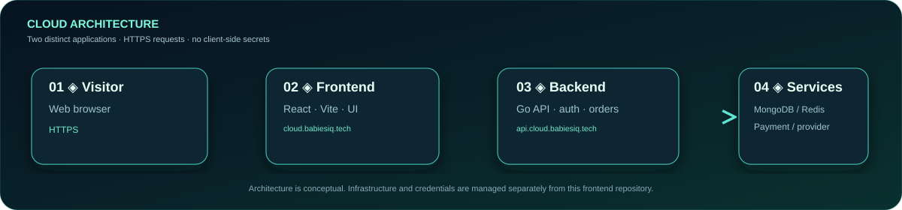

<div align="center">


# BabiesIQ Cloud
### Your cloud. Your rules.

**Modern cloud management • Linux VPS • Premium dashboard • Developer-friendly documentation**

[](https://cloud.babiesiq.tech)
[](https://cloud.babiesiq.tech/docs#developer-api)
[](https://t.me/BabiesIQ)

**Website:** https://cloud.babiesiq.tech · **Documentation:** https://cloud.babiesiq.tech/docs

</div>

> [!NOTE]
> This repository presents the **BabiesIQ Cloud website interface**, public features and setup guides. Platform internals and private configurations are intentionally outside the scope of this documentation. Artwork is illustrative, not live performance telemetry.

---

## ◈ Navigation

| Explore | Destination |
|:--|:--|
| **◇ Dashboard** | [Open BabiesIQ Cloud](https://cloud.babiesiq.tech) |
| **▣ Pricing** | [Plans & billing options](https://cloud.babiesiq.tech/pricing) |
| **⌘ Developer API** | [API Guide & examples](https://cloud.babiesiq.tech/docs#developer-api) |
| **◈ Documentation** | [Getting started](https://cloud.babiesiq.tech/docs) |
| **▤ Terms & Conditions** | [Service terms](https://cloud.babiesiq.tech/terms) |
| **◇ Privacy** | [Privacy policy](https://cloud.babiesiq.tech/privacy) |
| **↗ Community** | [Telegram @BabiesIQ](https://t.me/BabiesIQ) |

<details>
<summary><b>▸ Open the guide menu</b></summary>

- [Explore the cloud](#-explore-the-cloud)
- [Your journey](#-your-cloud-journey)
- [Local website setup](#-local-website-setup)
- [Website hosting guides](#-website-hosting-guides)
- [Custom domains & SSL](#-domains--ssl)
- [Host your own website on Linux](#-host-your-own-website-on-linux)
- [Developer API guide](#-developer-api-guide)
- [Service notes](#-service-notes)
- [Questions & support](#-questions--support)

</details>

---

## ◆ Explore the Cloud

<table>
<tr>
<td width="50%" valign="top"><b>◈ Cloud Dashboard</b><p>View your plans, instances, account settings and billing in a responsive workspace.</p></td>
<td width="50%" valign="top"><b>◇ Linux VPS</b><p>Explore eligible configurations and follow the connection instructions supplied with your service.</p></td>
</tr>
<tr>
<td valign="top"><b>⌘ Developer API</b><p>Find the public integration documentation and practical code examples.</p></td>
<td valign="top"><b>▣ Global Experience</b><p>Multiple language options, country and currency selections, dark and light themes.</p></td>
</tr>
<tr>
<td valign="top"><b>✦ Domains & Websites</b><p>Learn how to attach a domain and prepare a website for hosting.</p></td>
<td valign="top"><b>◇ Account & Billing</b><p>Review available billing terms, manage your account and find support.</p></td>
</tr>
</table>

| Feature | What to expect |
|:--|:--|
| **Linux VPS** | Available plans and specifications shown on the website |
| **RDP** | **COMING SOON** |
| **Billing terms** | 1 / 3 / 6 / 12-month choices where available |
| **Currency & country** | Options depend on the current offerings |
| **Dashboard** | Service, connection and billing information |
| **Domains** | Follow the domain options shown for your service |
| **Storage & backups** | Review your plan's terms; maintain independent backups |

<div align="center">

[](https://cloud.babiesiq.tech/pricing)

</div>

---

## ◇ Your Cloud Journey



| Step | Experience |
|:--|:--|
| **01 · Explore** | Find suitable plans and review available options |
| **02 · Configure** | Select preferences and read service terms |
| **03 · Get started** | Follow the instructions shown in your account |
| **04 · Manage** | Open Dashboard for details, billing and help |

<details>
<summary><b>▸ Website technology & folder overview</b></summary>

BabiesIQ Cloud's website interface uses **React**, **Vite**, **Tailwind CSS** and **React Router**.

```text
IQCloud/
├── assets/
│   ├── cloud-saas-live.svg       # animated README hero
│   └── cloud-architecture.svg    # customer journey illustration
├── public/                      # web assets and logos
├── src/
│   ├── App.jsx                  # website navigation
│   ├── pages/                   # pages and content
│   ├── components/              # reusable UI
│   └── i18n/                    # translations
├── scripts/                     # website checks
├── package.json
└── vite.config.js
```

The root-level `assets/` folder holds GitHub README artwork. The website's static assets are under `public/`.

</details>

---

## ⚡ Local Website Setup

<details open>
<summary><b>01 · Run the website on your computer</b></summary>

**Requirements:** Node.js 24, npm, Git and a browser.

```bash
git clone https://github.com/BabiesIQ/IQCloud.git
cd IQCloud
npm install --no-audit --no-fund
npm run dev
```

Open the URL shown by Vite, typically `http://localhost:5173`.

**Build a release preview:**

```bash
npm run build
npm run preview
```

| Command | Purpose |
|:--|:--|
| `npm run dev` | Local development |
| `npm run build` | Website build |
| `npm run preview` | Preview `dist/` output |
| `node scripts/check-active-routes.mjs` | Verify site navigation |

> Local website development and live account services are separate experiences. Use [the official website](https://cloud.babiesiq.tech) to access your account.

</details>

---

## 🚀 Website Hosting Guides

Choose your preferred host and open its guide. These steps describe **hosting a Vite single-page website**.

<details>
<summary><b>▸ 01 · Deploy with Railway</b></summary>

1. Open [Railway](https://railway.com/) and create a project.
2. Connect your GitHub repository and select the branch.
3. Use a compatible Node 24 build environment.
4. Build command: `npm run build`.
5. Serve the built `dist/` folder with SPA fallback. Example with a static server installed:

```bash
npx serve -s dist -l 3000
```

Set the port to the host's expected value when required, add the custom domain and verify SSL. For deep links such as `/docs`, ensure the server falls back to `index.html`.

</details>

<details>
<summary><b>▸ 02 · Deploy to Vercel</b></summary>

1. Open [Vercel New Project](https://vercel.com/new).
2. Import the repository, choose **Vite**, build with `npm run build` and output `dist`.
3. If needed, add SPA routing to `vercel.json` in your own deployment:

```json
{
  "rewrites": [
    { "source": "/(.*)", "destination": "/index.html" }
  ]
}
```

4. Configure the desired domain in Vercel.

</details>

<details>
<summary><b>▸ 03 · Deploy to Netlify</b></summary>

1. [Netlify](https://app.netlify.com/start) → Add new site → connect GitHub.
2. Build: `npm run build`; publish directory: `dist`.
3. If your deployment needs SPA fallback, add this to `public/_redirects`:

```text
/*    /index.html    200
```

4. Add the domain, enable HTTPS and test direct navigation to nested pages.

</details>

<details>
<summary><b>▸ 04 · Deploy to Cloudflare Pages</b></summary>

1. Open [Cloudflare Dashboard](https://dash.cloudflare.com/).
2. Workers & Pages → Create a Pages project, connect the repository.
3. Framework: Vite; command: `npm run build`; directory: `dist`.
4. Confirm SPA navigation, attach the domain and check SSL.

</details>

<details>
<summary><b>▸ 05 · Deploy to Render</b></summary>

1. Open [Render](https://dashboard.render.com/) and create a **Static Site**.
2. Connect GitHub; build: `npm install && npm run build`.
3. Publish: `dist`.
4. Add a rewrite rule from `/*` to `/index.html`, then attach the domain.

</details>

<details>
<summary><b>▸ 06 · Use your own Ubuntu VPS with Nginx</b></summary>

Install a supported Node.js version and Git. Then:

```bash
sudo apt-get update
sudo apt-get install -y git nginx
git clone https://github.com/BabiesIQ/IQCloud.git
cd IQCloud
npm install --no-audit --no-fund
npm run build
sudo mkdir -p /var/www/iqcloud
sudo cp -a dist/. /var/www/iqcloud/
```

Example Nginx site configuration:

```nginx
server {
    listen 80;
    server_name cloud.example.com;
    root /var/www/iqcloud;
    index index.html;
    location / { try_files $uri $uri/ /index.html; }
}
```

Enable this server block in Nginx, run `sudo nginx -t`, then reload Nginx. Configure DNS and HTTPS using your hosting provider's instructions.

</details>

<details>
<summary><b>▸ Compare web hosting options</b></summary>

| Host | Build | Output | Routing |
|:--|:--|:--|:--|
| Railway | `npm run build` | `dist/` | Static server with SPA fallback |
| Vercel | `npm run build` | `dist/` | Rewrite to `index.html` |
| Netlify | `npm run build` | `dist/` | `_redirects` |
| Cloudflare Pages | `npm run build` | `dist/` | SPA routing |
| Render | `npm run build` | `dist/` | Rewrite rule |
| VPS + Nginx | `npm run build` | Web directory | `try_files` |

</details>

---

## ◈ Domains & SSL

<details>
<summary><b>▸ Connect a domain to a hosted website</b></summary>

1. Add your desired domain in your hosting dashboard.
2. Copy the exact DNS record that host provides.
3. Add it at your DNS provider. For example:

| Type | Name | Target |
|:--|:--|:--|
| CNAME (if requested) | `cloud` | Host-supplied DNS target |
| TXT (if requested) | As instructed | Verification value |

4. Wait for verification and SSL certificate issuance.
5. Test the home page and nested links by refreshing them directly.

**Do not put a port number inside a CNAME.** DNS and website port routing are different things.

</details>

<details>
<summary><b>▸ Add a domain to your BabiesIQ Cloud service</b></summary>

Visit [cloud.babiesiq.tech](https://cloud.babiesiq.tech), open your instance and choose the available domain options. Enter the application port if supported, then follow the dashboard's exact DNS and verification steps. Domain availability depends on the selected service.

</details>

<details>
<summary><b>▸ Fix domain and website problems</b></summary>

| Problem | What to check |
|:--|:--|
| Home works but other pages return 404 | SPA rewrite / fallback |
| Site shows 502 | Web service process and port |
| SSL warning | DNS record and certificate status |
| Domain not connected | Hosting validation and DNS propagation |
| Page does not update | Build, deployment and cache |
| SSH works but website does not | Website connectivity requires separate HTTP routing |

</details>

---

## ◇ Host Your Own Website on Linux

<details>
<summary><b>▸ Step 01 · Connect to a Linux server</b></summary>

Use the connection details shown for your service:

```bash
ssh -p YOUR_PORT root@YOUR_ASSIGNED_HOST
```

The assigned address, login method and port are displayed in your account. Never include real passwords in screenshots or publicly accessible files.

</details>

<details>
<summary><b>▸ Step 02 · Install and serve an HTML website</b></summary>

On a compatible Ubuntu system:

```bash
sudo apt-get update
sudo apt-get install -y nginx
sudo mkdir -p /var/www/mysite
echo '<h1>Hello from my website</h1>' | sudo tee /var/www/mysite/index.html
```

Set your Nginx document root to `/var/www/mysite`, validate the configuration and check `http://127.0.0.1/`. Public access requires the correct hosting and domain configuration.

</details>

<details>
<summary><b>▸ Step 03 · Reverse proxy a web application</b></summary>

If your app serves `127.0.0.1:3000`, an example Nginx site:

```nginx
server {
    listen 80;
    server_name app.example.com;
    location / {
        proxy_pass http://127.0.0.1:3000;
        proxy_set_header Host $host;
        proxy_set_header X-Forwarded-Proto $scheme;
    }
}
```

Validate local operation, configure your host's allowed website ports and set up TLS. Keep independent backups.

</details>

---

## ⌘ Developer API Guide

<div align="center">

[](https://cloud.babiesiq.tech/docs#developer-api)

</div>

The official [BabiesIQ Cloud Developer API Guide](https://cloud.babiesiq.tech/docs#developer-api) contains integration examples, available methods, request formats and developer instructions.

<details>
<summary><b>▸ 01 · Discover plans</b></summary>

Use the documented public plan catalog:

```bash
curl -sS "https://api.cloud.babiesiq.tech/linux/price-list?currency=INR"
```

The response reflects the current catalog. Availability and purchasing options must be verified from the site.

</details>

<details>
<summary><b>▸ 02 · API setup and examples</b></summary>

1. Sign in at [BabiesIQ Cloud](https://cloud.babiesiq.tech).
2. Open the [Developer API documentation](https://cloud.babiesiq.tech/docs#developer-api).
3. Follow the account setup and examples shown in that guide.
4. Review the published limits and terms for your use case.

Use the official documentation for current integration requirements.

</details>

<details>
<summary><b>▸ 03 · Guides and developer support</b></summary>

**[Read the full Developer API Guide](https://cloud.babiesiq.tech/docs#developer-api)**

For questions and updates, see [@BabiesIQ](https://t.me/BabiesIQ).

</details>

---

## ▣ Service Notes

<details>
<summary><b>▸ Pricing, renewals, RDP and data safety</b></summary>

- Review current [VPS prices](https://cloud.babiesiq.tech/pricing) before ordering.
- **RDP: COMING SOON.**
- Check the eligible countries, currencies and billing terms on the website.
- Keep backups of important files.
- Read the [Terms of Service](https://cloud.babiesiq.tech/terms) and [Privacy Policy](https://cloud.babiesiq.tech/privacy).

</details>

---

## ◇ Questions & Support

<details>
<summary><b>Can I try the website locally?</b></summary>

Yes. Follow the Local Website Setup section. To purchase and manage services, visit the official BabiesIQ Cloud website.

</details>

<details>
<summary><b>Can I launch a website on my Linux VPS?</b></summary>

Follow the Linux website-hosting guide above. Check your service's available port and domain features first.

</details>

<details>
<summary><b>Is Windows RDP available?</b></summary>

Not yet. Windows RDP is labeled **COMING SOON**.

</details>

<details>
<summary><b>Is the animated banner real-time service monitoring?</b></summary>

No. It is an animated brand illustration, not a source of live usage or performance statistics.

</details>

---

## ♡ Contributing & Community

```bash
git checkout -b feat/site-improvement
npm install
npm run build
```

Read [Documentation](https://cloud.babiesiq.tech/docs), join [Telegram](https://t.me/BabiesIQ) or visit [GitHub](https://github.com/BabiesIQ/IQCloud).

<div align="center">

### Made for builders by BabiesIQ

[](https://cloud.babiesiq.tech)
[](https://cloud.babiesiq.tech/docs#developer-api)

<sub>BabiesIQ Cloud · Public website documentation · © 2026</sub>

</div>
